# KodiWise

**Fair rent estimates for Nairobi homes, with augmented-reality previews.**

KodiWise is an Android app backed by a machine-learning API. A tenant or landlord enters what they know about a home (neighbourhood, bedrooms, bathrooms and, optionally, size, type, furnishing and amenities) and gets an estimated monthly rent **as a range**, together with an honest note on how much local data supports that estimate. Landlords can list properties, an admin approves them, tenants browse approved listings and can open an augmented-reality (AR) view of a listing. Landlords attach up to 8 photos to a listing; AR places a listing's photo gallery in the room, and listings without photos show an info card instead.

*Kodi* is Swahili for "rent".

KodiWise is the product successor to **RentAR**, my MSc research prototype at Strathmore University, which was published as a conference paper (see [Research background](#research-background)). KodiWise rebuilds that prototype around one principle: **the model must only learn from information the app can actually collect from a user**, and every number it shows must be one we can defend.

---

## Contents

1. [Features](#features)
2. [Screenshots](#screenshots)
3. [How it works](#how-it-works)
4. [Repository structure](#repository-structure)
5. [The machine-learning model](#the-machine-learning-model)
6. [Results](#results)
7. [The prediction API](#the-prediction-api)
8. [Rent Assistant (free, no AI)](#rent-assistant-free-no-ai)
9. [AI assistant (MCP)](#ai-assistant-mcp)
10. [Ask KodiWise: AI chat, free tier, limits, privacy](#ask-kodiwise-ai-chat-free-tier-limits-privacy)
11. [The Android app](#the-android-app)
12. [Data model and security rules](#data-model-and-security-rules)
13. [Getting started](#getting-started)
14. [Testing](#testing)
15. [Model versioning and deployment rule](#model-versioning-and-deployment-rule)
16. [Limitations](#limitations)
17. [Roadmap](#roadmap)
18. [Research background](#research-background)
19. [Author](#author)

---

## Features

**For tenants**
- Estimate a fair monthly rent for any of 32 Nairobi neighbourhoods, shown as a likely range (low – estimate – high) rather than one misleading number.
- Location confidence hint: *high*, *low* ("treat this estimate as rough") or *none* ("based mostly on the Nairobi average").
- **Find areas for my budget** (Rent Assistant): enter a budget, bedrooms and bathrooms, optionally "near this area" within 2, 5 or 10 km, and see which neighbourhoods are comfortable or a stretch, with the estimate, range and a confidence warning for each. It runs on free rules and the existing rent model, with no AI service.
- **Is this rent fair?** Enter an asking rent and see whether it is within, above or below the estimated range, or get no verdict when local data is too thin.
- Browse admin-approved listings, search them, and see whether a listing's asking rent is **within, above or below** the estimated range.
- Listing photos on cards and in a gallery on the detail screen.
- AR view on ARCore phones places a listing's photo gallery in the room. Listings without photos show an info card (title, area, beds, baths, rent and range) instead. Phones without ARCore get a details screen.

**For landlords**
- Add a listing (neighbourhood picked from a validated list, size, type, furnishing, amenities). Each listing is priced against the model at upload time.
- Manage and delete their own listings; see approval status (pending, approved, rejected) and admin notes.

**For admins**
- Review pending listings and approve or reject them with a note.
- A performance screen for timing API and database calls.

**Across the app**
- Material 3 design in a deep-green and gold theme, with full light and dark mode.
- Role-based routing (tenant, landlord, admin) with a bottom navigation bar for each role.
- Accessibility: 4.5:1 contrast, 48 dp touch targets, labelled icons.

---

## Screenshots

| Login | Tenant home | Rent estimate form | Estimate result |
|---|---|---|---|
| 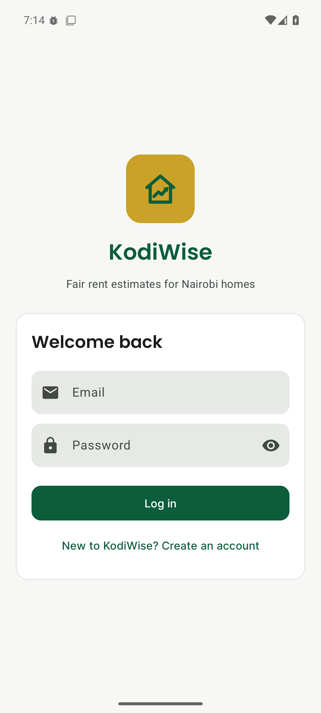 | 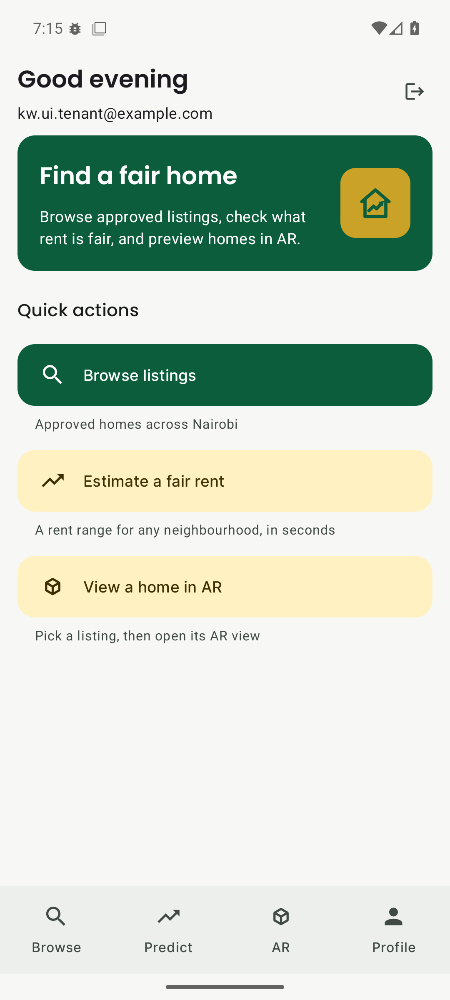 | 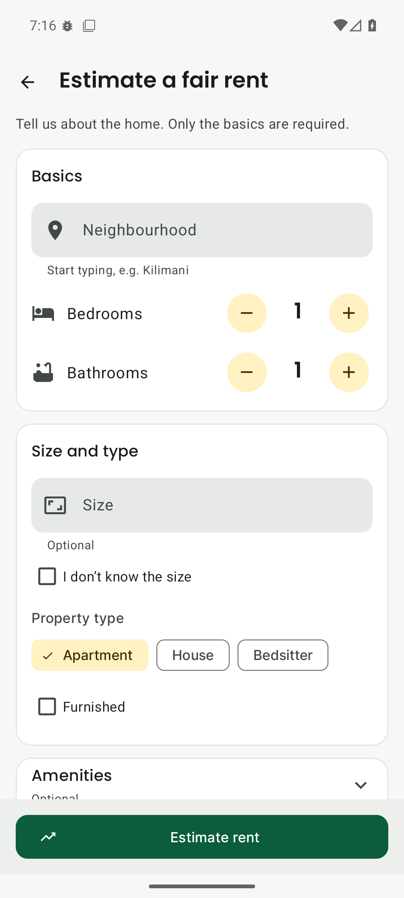 | 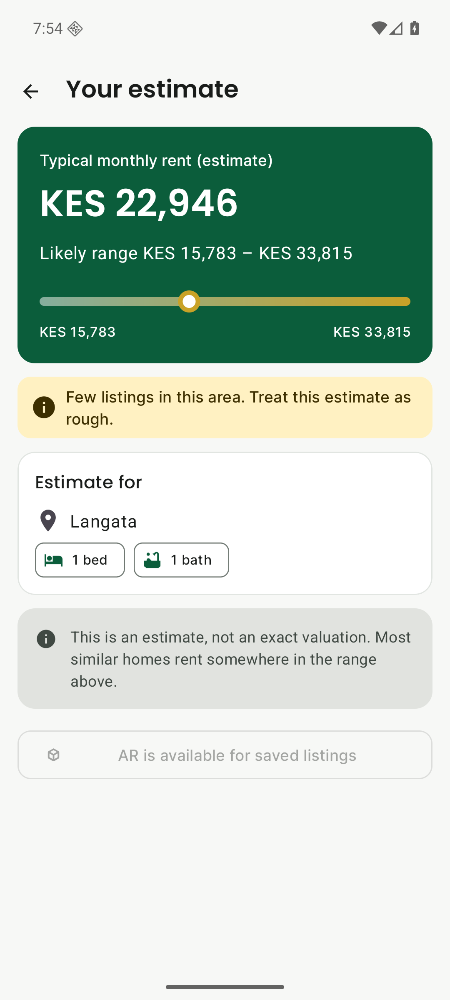 |

| Listing detail | Admin review | AR view | Dark mode |
|---|---|---|---|
| 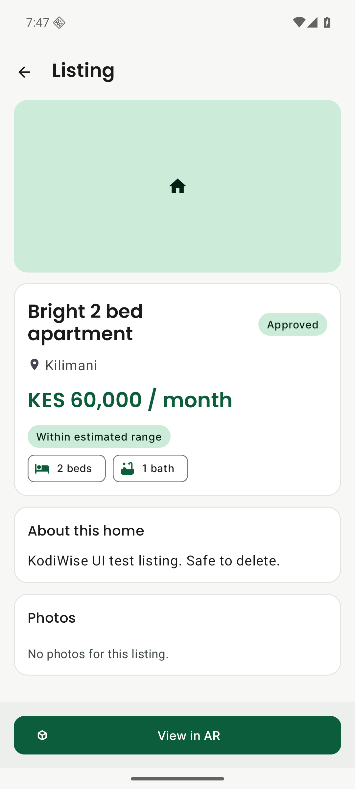 | 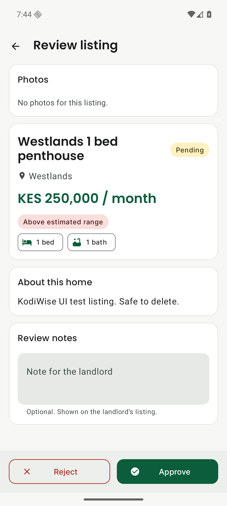 | 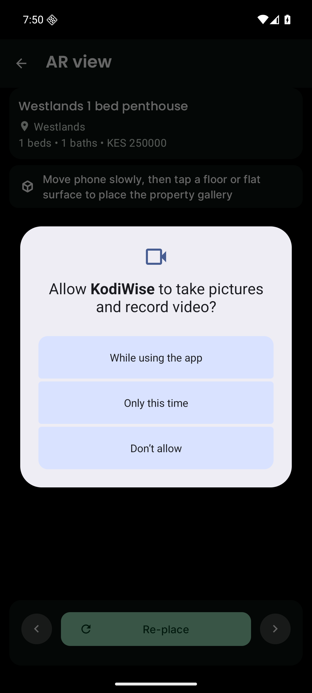 | 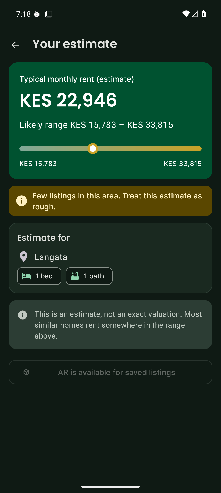 |

More screens, in light and dark mode, are in [`docs/screenshots/after/`](docs/screenshots/after/).

---

## How it works

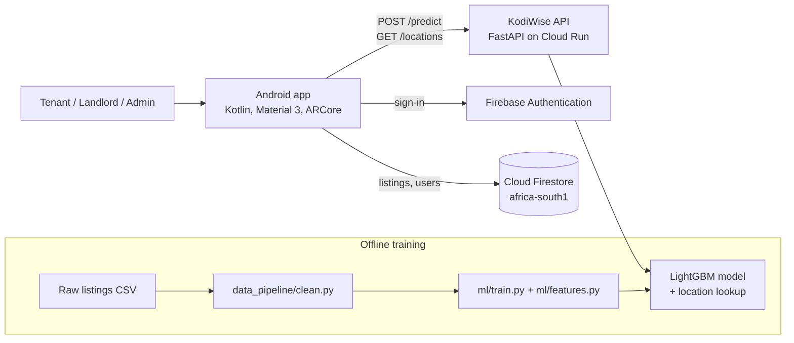

1. **Data**: rental listings scraped from Kenyan property sites are cleaned by `data_pipeline/clean.py`.
2. **Training**: `ml/train.py` builds features with `ml/features.py` and trains a LightGBM model. Every model is saved as an immutable, versioned folder with its metrics.
3. **Serving**: the API in `api/` loads one model version and uses **the same `ml/features.py` code** to turn a request into features, so training and serving cannot drift apart.
4. **App**: the Android app calls the API for estimates and uses Firebase for sign-in and listings.

---

## Repository structure

```
KodiWise/
├── android_app/            Android app (Kotlin, XML views, Material 3, ARCore)
│   └── app/src/main/java/com/kodiwise/app/
├── agent/                  MCP server for AI assistants (agent/core = tool logic)
├── chat/                   kodiwise-chat: Gemini chat service for the app (Cloud Run)
├── api/                    FastAPI prediction service
│   ├── main.py             endpoints
│   ├── predictor.py        loads the model, builds features, returns a range
│   └── schemas.py          request/response models (Pydantic)
├── ml/                     model code and saved versions
│   ├── features.py         single source of truth for features (train + serve)
│   ├── train.py            training, versioning, deploy comparison
│   ├── evaluate.py         metrics, cross-validation, baselines
│   └── models/<version>/   metrics, feature importance, location lookup
├── data_pipeline/
│   ├── clean.py            cleaning rules, logs every dropped row
│   └── geocode.py          neighbourhood centroids, reference points and roads (OpenStreetMap)
├── data/reference/         neighbourhood_centroids.csv, pois.csv, roads.csv (+ cached OSM responses)
├── tests/                  pytest suite (features, cleaning, API, deploy rule)
├── docs/screenshots/       before/after app screenshots
├── firestore.rules         database security rules
├── firestore.indexes.json  composite indexes
├── Dockerfile              API container image
└── requirements.txt        pinned Python dependencies
```

Raw listing data and trained model binaries are deliberately **not** committed (see `.gitignore`); the OpenStreetMap-derived reference files in `data/reference/` are.

---

## The machine-learning model

### Data

The starting dataset has **580 Nairobi rental listings** (489 from Jiji, 91 from KenyaPropertyCentre) across 34 neighbourhoods, with 60 columns.

### Data collection (weekly, local)

New listings come from **Jiji only**, once a week, from the maintainer's own machine
(`python -m data_pipeline.job`, scheduled with Windows Task Scheduler by
`infra/run_scrape.ps1` and `infra/kodiwise_scrape_task.xml`). Each run writes a **new dated dataset** to a
private Cloud Storage bucket and never overwrites an existing one.

- **Runs hidden and survives normal laptop use:** the task launches PowerShell through `conhost.exe --headless`
  (no console window to close), runs only while you are logged on (no password is stored; it uses your own gcloud
  login), may start and continue on battery, runs as soon as possible after a missed start (once the network is up),
  starts no second copy while one is running, and is stopped after 1 hour. The script keeps Windows awake while it
  runs and releases that when it ends. Re-import the task after editing the XML:
  `schtasks /Create /TN "KodiWise Weekly Scrape" /XML "C:\Projects\KodiWise\infra\kodiwise_scrape_task.xml" /F`.
- **Always logged:** every run writes a start line and an end line with the exit code to
  `%LOCALAPPDATA%\KodiWise\logs\scrape_YYYYMMDD.log`, and a `runs/<time>.json` log to the bucket even on failure
  (`status` is `ok`, `stopped` or `error`) when the network is up. Exit codes: 0 ok, 1 crashed or lost the network
  part-way (rows fetched so far are kept), 2 script failure, 3 HTTP 403/429 (week skipped).

- **Why Jiji only:** its terms have no automated-access clause (§7.16 on copying other users' content is
  respected by keeping text private). KenyaPropertyCentre's terms forbid automated access, Property24's
  forbid robots, and BuyRentKenya blocks automated clients, so none of them are scraped.
- **Politeness:** a User-Agent naming this repo, at least 3 s between requests, robots.txt checked before every
  fetch, at most 300 listing pages per run. On any HTTP 403/429 the run **stops and that week is skipped**.
  There are no proxies or IP rotation.
- **Data minimisation:** only parsed numeric and flag fields and place names are kept. Titles, descriptions,
  photos and advertiser data are not stored (the fingerprint is stored as a hash). The raw HTML of the latest
  run is kept privately for re-parsing and older runs are deleted.
- **Cleaning:** the same rules as `data_pipeline/clean.py`, unchanged (including the KES 300,000 cap).
- **Credentials:** your own `gcloud auth application-default login`; no key files.
- A Cloud Run Job was tried and removed: Jiji returns HTTP 403 to Google Cloud addresses.
- Scraped data and snapshots are never committed.

### Cleaning (`data_pipeline/clean.py`)

Each rule runs in order and logs row counts; every removed row is written to `dropped_rows.csv` with a reason.

| Step | Rule | Rows |
|---|---|---|
| Start | Raw listings | 580 |
| 1 | Drop listings outside Nairobi County (e.g. a Nakuru listing labelled "Pipeline") | −1 |
| 2 | Drop short-stay listings (Airbnb, per-night, hostel, daily/weekly) by title keywords | −18 |
| 3 | Drop rents under KES 8,000 (short-let or mislabelled) | −9 |
| 4 | Keep rents between KES 3,000 and 300,000 | 0 |
| 5 | Drop dead columns; floor area outside 15–1,000 m² treated as missing (34 values, no rows dropped) | 0 |
| **Result** | | **552** |

### Avoiding leakage

The original research prototype reached R² ≈ 0.97 because some features were computed from the rent itself (price per bedroom, location averages over all data). KodiWise removes every such feature:

- No feature may be derived from the target (rent).
- Location statistics (mean, median, count) are computed **from the training split only**, smoothed towards the city mean (weight *m* = 5), and **recomputed inside each cross-validation fold**.
- Unknown neighbourhoods fall back to the Nairobi average and are flagged.

### Avoiding training–serving skew

The most important lesson of this project. A model that scored **R² 0.77** on held-out listings turned out to depend mostly on the listing's *title* (title length alone was the top feature, because it identified which website a listing came from, and the sites differ in price level). The app never has a real title, so when that model was given the inputs the app actually sends, its R² fell to **−0.38**: worse than always guessing the average.

KodiWise therefore trains only on fields a user can enter in the app:

| Group | Features |
|---|---|
| Required | neighbourhood, bedrooms, bathrooms |
| Optional | floor area (m², with "don't know"), furnished, property type (apartment / house / bedsitter) |
| Optional amenities | generator, borehole, CCTV, DSQ, play area, garden |
| Derived | rooms total, bathrooms per bedroom, location mean/median/count (training data only) |
| Location geography | neighbourhood latitude/longitude; km to the CBD, Westlands, Upperhill, JKIA, Thika Road and Mombasa Road (looked up from the neighbourhood name) |

### Model

- **LightGBM** regression on `log1p(rent)` (via `TransformedTargetRegressor`).
- Hyperparameters: 2,000 trees, learning rate 0.03, 64 leaves, min 15 samples per leaf, 0.85 row and column subsampling, L1/L2 0.2.
- Stratified 80/20 split by income band, 5-fold cross-validation.
- Compared against Ridge regression, Random Forest and XGBoost.

### Prediction range

Instead of one number, the API returns the 10th–90th percentile range of the model's cross-validation errors (in log space) around the estimate. Typical range width for the served model is about KES 50,000.

### Location confidence

Some neighbourhoods have very few listings, so their average is effectively one or two homes. Each prediction reports:

| Confidence | Training listings in the neighbourhood | What the app shows |
|---|---|---|
| high | 10 or more | no note |
| low | 3–9 | "Few listings in this area. Treat this estimate as rough." |
| none | fewer than 3, or unknown | "Not enough local data. This estimate is based mostly on the Nairobi average." |

---

## Results

All figures are on the held-out test set unless marked CV (5-fold cross-validation).

| Run | Features | Test R² | Test MAPE | Status |
|---|---|---|---|---|
| A: research reproduction | full research feature set, 580 rows | 0.723 | 25.2% | matches the published paper (R² 0.724, MAPE 25.3%) |
| B: cleaned, all features | includes title text | 0.774 | 20.2% | **not usable**: R² −0.38 with real app inputs |
| C: app inputs only | neighbourhood, bedrooms, bathrooms | 0.489 | 41.3% | first honest baseline |
| D: expanded app form | C + size, type, furnishing, amenities | 0.736 | 24.7% | previous production (`v20261107-appD`) |
| E2: D + GPS | D + neighbourhood coordinates and distances | 0.748 | 24.8% | previous production (`v20261107-appE2`) |
| **F: E2 features, 806 listings (served)** | same features, retrained on the 23 Nov dataset | **0.718** | **27.4%** | in production (`v20261123-appF`) |

Baselines on the same split for the served model (F): Random Forest R² 0.740 / MAPE 26.5%, XGBoost 0.698 / 27.2%, Ridge 0.008 / 31.7%.

Adding six form fields recovered almost all of the accuracy that title text had been faking, and the typical estimate range became about 31% narrower than with Run C.

**Run F (retrained on 806 listings, 254 new).** Run F uses exactly the E2 features and settings; only the data changed (the new rows are almost all Jiji listings, collected mostly for the thin neighbourhoods). The F row in the table is on its own, different 20% split (162 test rows), so it is **not comparable** with the E2 row. The deciding comparison is the deploy rule on the same rows, averaged over 5 seeds, against E2: on E2's 111 test rows mean test MAPE went from 24.66% to 23.58% (−1.08 points, better in all 5 seeds). Strict CV R² (scored on E2's training rows only, new rows always in training) went from 0.720 to 0.716 (−0.004, within the 0.01 limit). Out-of-fold error on the new rows was 28.2% against 31.3% for E2, with the largest gains in Spring Valley, Loresho, Karen and Ngara; Westlands, Kahawa and South B were worse. Location confidence changed for 9 neighbourhoods (for example Dagoretti, Spring Valley, Hurlingham and Ngara are now "high"; Upperhill, Loresho and Gigiri are "low"). Details: `ml/models/v20261123-appF/retrain_report.json`.

Known caveats of Run F (decided with open eyes, re-checked at every retrain):

- **Strict CV R² is slightly lower** than E2's (−0.004, negative in all 5 seeds) although test MAPE is better.
- **The Furnished effect is large.** In "Why this estimate" it can be 37–50% of a furnished listing's estimate (for example +KES 55,000 on a 2-bed in Kilimani). Furnished listings are only 15% of the rows and their median rent is KES 140,000 against 60,000 for the rest, so the model cannot separate furnishing from other things that come with it. Treat it with care.
- **Loresho, Upperhill and Gigiri rest on very little data** (7, 9 and 4 training rows; confidence "low"). Loresho's 1-bed estimate moved from about KES 67,000 to 31,000 with the retrain, so expect these areas to change as rows arrive.
- **The Kileleshwa vs Lavington gap shrank** (3-bed, 2-bath: about KES 5,000 apart, from 28,000). The order is unchanged.
- Neighbourhoods with fewer than 3 training rows ("none") got slightly worse out-of-fold (44.0% → 46.0%, 17 rows).

**GPS features (Run E2).** Each neighbourhood gets OpenStreetMap coordinates and distances to the CBD, Westlands, Upperhill, JKIA, Thika Road and Mombasa Road; the app request does not change. Compared with Run D on the same rows and folds, averaged over 5 training seeds, mean test MAPE went from 24.91% to 24.66% and CV R² from 0.719 to 0.720. The gain is concentrated where location data is thin: out-of-fold error for neighbourhoods with 3–9 training listings fell by about 5 points (34.6% → 29.5%), while neighbourhoods with fewer than 3 listings did not improve (42.8% → 44.0%), so their "not enough local data" label stays. A variant that also borrowed rents from nearby neighbourhoods (Run E, a spatial prior) added nothing measurable and is not served. On the single split in the table, E2's MAPE is 0.1 points above D's; the 5-seed comparison is the deciding measure, because training noise alone moves test MAPE by up to ~0.8 points at this data size.

---

## The prediction API

FastAPI service in `api/`, containerised with the root `Dockerfile` and deployed to Google Cloud Run (africa-south1, scales to zero).

| Method | Path | Purpose |
|---|---|---|
| GET | `/health` | Service status and loaded model version |
| GET | `/model-version` | Version, feature set and test metrics of the served model |
| GET | `/locations` | The 32 neighbourhoods the model recognises |
| POST | `/predict` | Rent estimate with range, confidence and a "why this estimate" explanation |
| GET, POST | `/areas-within-budget` | Areas that fit a monthly budget, split into comfortable and stretch, optionally near an area (see [Rent Assistant](#rent-assistant-free-no-ai)) |

**Request** (only the first three fields are required):

```json
{
  "bedrooms_num": 2,
  "bathrooms_num": 2,
  "location_std": "kilimani",
  "sq_m": 110,
  "is_furnished": 1,
  "property_type": "apartment",
  "has_generator": 1,
  "has_borehole": 1,
  "has_cctv": 1,
  "explain": true
}
```

`explain` is optional and defaults to `true`; send `false` to get only the estimate.

**Response**

```json
{
  "predicted_rent_kes": 139313.54,
  "predicted_rent_low_kes": 94734.21,
  "predicted_rent_high_kes": 208461.66,
  "model_version": "v20261123-appF",
  "location_recognised": true,
  "location_confidence": "high",
  "note": "Estimate only, not an exact valuation. ...",
  "explanation": {
    "baseline_rent_kes": 59004,
    "factors": [
      {"name": "Furnished", "label": "Furnished", "direction": "+", "effect_kes": 60467},
      {"name": "Location", "label": "Kilimani location", "direction": "+", "effect_kes": 55600},
      {"name": "Amenities", "label": "Amenities: generator, CCTV", "direction": "+", "effect_kes": 6543},
      {"name": "Size", "label": "Size (90 m²)", "direction": "-", "effect_kes": -5613},
      {"name": "Bedrooms/Bathrooms", "label": "2 bedrooms, 2 bathrooms", "direction": "+", "effect_kes": 4840}
    ],
    "note": "Approximate. Each effect is how much lower the estimate would be if that factor were average, ..."
  }
}
```

**How the explanation works.** It uses LightGBM's built-in tree SHAP on the served model, with no extra dependency. The raw features are folded into six factors: Location (neighbourhood statistics, coordinates and distances), Size, Bedrooms/Bathrooms, Property type, Furnished and Amenities. A factor's effect is `estimate × (1 − e^(−c))`, where `c` is its log-space contribution: roughly, how much lower the estimate would be if that factor were average. Up to 5 factors are returned, largest first, and any smaller than `max(2% of the estimate, KES 1,000)` are hidden. The effects are approximate and do not add up exactly in KES, because the model works in log space. `baseline_rent_kes` is a typical rent with nothing known about the home, not the average of all rents. If the size was not given, the Size factor says a typical size was used.

In the app, the result screen shows a "Why this estimate" card with the top factors and a small bar for each:

| Light | Dark |
|---|---|
| 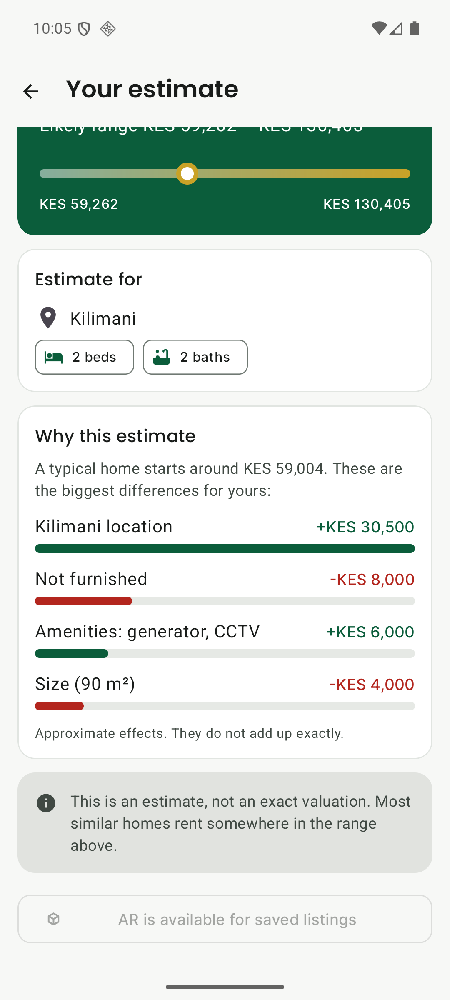 | 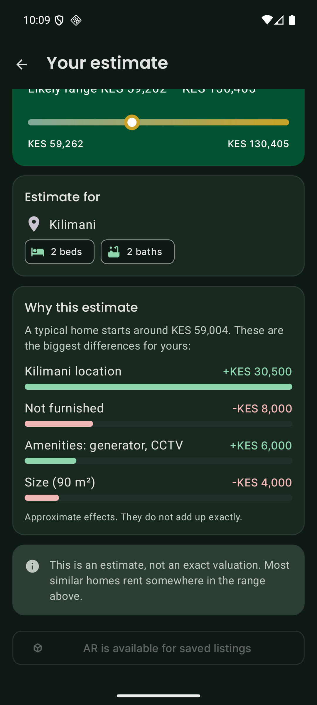 |

Location names are matched case-insensitively, with a small alias table (e.g. "Westland" → Westlands, "Upper Hill" → Upperhill). Invalid input returns HTTP 422 with a clear message.

---

## Rent Assistant (free, no AI)

"Find areas for my budget" in the app (tenant Home, and a button on the Estimate screen) answers: *where could my rent go?* It costs nothing to run beyond the API the app already uses: no Claude API, no other paid service, no model calls to a third party.

**Flow**

1. **Budget:** monthly budget in KES (3,000 to 2,000,000), bedrooms, bathrooms.
2. **Near an area (optional):** pick an area from the list and a distance of 2, 5 or 10 km (straight line between neighbourhood centre points, not travel time).
3. **Results:** two sections.
   - **Comfortable:** the estimate is at or under the budget. Without a "near" filter these are listed with the highest estimate first (most home for the money); with one, nearest first.
   - **Stretch:** only the low end of the range fits the budget.
   - Areas whose whole range is above the budget are left out (the count is shown).

Each card shows the area, distance (when "near" is used), the estimate, a range bar, and a warning chip when local data is thin ("low": rough estimate; "none": based mostly on the Nairobi average). Tapping a card opens the full estimate with "Why this estimate". An "Estimate only" note is always shown.

**Is this rent fair?** (a shortcut on the first step and on the results screen) takes an area, bedrooms, bathrooms and an asking rent, and says whether it is within, above or below the estimated range. When local data for the area is too thin it gives no verdict. This uses the same rule as the MCP `check_listing_price` tool and the listing range badge.

**Backend:** `GET` or `POST /areas-within-budget` (`budget_kes`, `bedrooms`, `bathrooms`, optional `near`, `max_km`, `sq_m`) runs the same `agent/core` logic as the MCP `areas_within_budget` tool, against the in-process model (`api/areas.py`). Work per request is capped:

- at most 32 model runs (the number of covered areas), with explanations switched off for the sweep;
- at most 2 sweeps at a time; extra requests get HTTP 429 and the app asks the user to retry;
- inputs are validated (budget range, 0 to 10 bedrooms and bathrooms, `max_km` 0.5 to 50, a known `near` area), and bad input returns HTTP 422 with a plain-language message.

```
GET /areas-within-budget?budget_kes=60000&bedrooms=2&bathrooms=1&near=Kilimani&max_km=5
```

Everything it returns is an estimate, never a promise or a valuation.

---

## Ask KodiWise: AI chat, free tier, limits, privacy

"Ask KodiWise" is a short chat in the Android app (tenant Home and the Predict tab). It answers rent questions in plain language, using the same estimate tools as the rest of KodiWise. It is **free to run**: it uses the Gemini API free tier from a Google Cloud project with no billing account (`kodiwise-ai-free`), so there is no way for it to be charged. If the free quota runs out, the chat stops and the guided Rent Assistant (no AI, no limit) keeps working.

**How it works.** The app sends the user's last six messages and their Firebase sign-in token to `kodiwise-chat`, a small Cloud Run service (`chat/`, region africa-south1, scales to zero). The service checks the token, strips personal details, and runs a Gemini function-calling loop over `agent/core` tools (estimate, compare areas, areas within a budget near a place, fair-rent check, locations, approved listings). Those tools call `kodiwise-api`; Gemini never produces a price on its own. Nothing is stored on the server except two usage counters.

**Guardrails (enforced in code, not only in the prompt).**
- At most **4 tool calls** per message, and short answers.
- **Numbers only from tools.** Every amount of KES 1,000 or more in the reply must match a number from a tool result (or one the user typed). If not, the reply is replaced with wording built from the tool data.
- **Range, confidence, "estimate only".** Added to the reply automatically if the model leaves them out; thin data (low or no local listings) is always stated.
- The cards under an answer (estimate with range bar, area lists, listings) come from the tool results, not from the model's text.
- Listing titles are treated as data, never as instructions; owner ids and contact details are never read or sent. No legal, tenancy or financial advice, and no claims about photos.

**Limits.**
- **15 messages per user per day** (a Firestore counter; the day ends at midnight in Nairobi).
- **A global daily cap** on Gemini requests, set at 60% of the free daily request limit (the day ends at midnight Pacific, when Google's quota resets), plus a per-minute cap below the free requests-per-minute limit. One chat message can use several Gemini requests, so the cap counts requests, not messages.
- When a limit is hit or Gemini answers "too many requests", the app shows a friendly message and an **Open the Rent Assistant** button. A failed call is not counted against the user.
- Current values: set on deploy (`infra/deploy_chat.ps1 -Model -DailyCap -Rpm`); see the deploy notes in `docs/PROGRESS.md`.

**Privacy.** On the free tier Google may use what is sent to it, so:
- Before anything is sent, **phone numbers, emails, links, long ID-like numbers and names** the user gives ("my name is ...", their own account name) are removed. Names in free text cannot be detected perfectly, so the screen always shows **"Don't share personal details."**
- Owner data of listings is never sent. Only the last six messages are sent, and the server keeps no conversation: only a count per user per day and one global count per day, with no message text.
- **Kenya only.** The free tier is not available to users in the EU, UK or Switzerland. The server cannot tell where a user is without a paid load balancer, so availability is limited by distributing the app in Kenya only (Play Store country targeting).

**Secrets.** The Gemini key is stored only in Google Secret Manager (`kodiwise-gemini-key`) and given to the chat service as an environment secret. It is never in the app or this repository, and it must come from the unbilled project, never from a billed one.

**Deploy.** `infra/deploy_chat.ps1` stages `chat/`, `agent/core/` and the neighbourhood centre points into a temporary folder and deploys `kodiwise-chat`. `python -m chat.model_eval <model-id> ...` runs the six demo questions against a model and reports tool-calling accuracy and guardrail failures.

---

## AI assistant (MCP)

An [MCP](https://modelcontextprotocol.io) server in `agent/` lets an AI assistant such as Claude Desktop answer Nairobi rent questions with KodiWise's real data. It is deliberately thin: every number comes from the live `kodiwise-api` over HTTPS, so there is one source of truth. It never loads the model and never writes anything.

| Tool | What it does |
|---|---|
| `list_locations` | The 32 neighbourhoods KodiWise covers. |
| `estimate_rent` | One home: estimate, likely range, location confidence, and the main reasons (approximate KES effects). |
| `compare_areas` | The same home in 2–6 areas, ranked by estimate, each with range and confidence. |
| `areas_within_budget` | Which areas fit a monthly budget: "comfortable" (estimate at or under budget) and "stretch" (only the low end of the range fits). Optional `near` (neighbourhood) and `max_km` (default 5) limit it to areas within that straight-line distance, nearest first, and report which areas were within range. At most 32 estimates, cached for the session. |
| `check_listing_price` | Whether an asking rent is within, above or below the estimated range, using the same rule as the app. With too little local data it says "no verdict" and still shows the range. |
| `search_listings` | Approved listings only, read-only: title, area, rent, beds, baths, size and the range badge. |

**Guardrails**

- **Read-only.** No tool writes anything.
- **Numbers come from tools.** Every result carries the range, the location confidence and an "estimate only, not a valuation" note, added in one place so it cannot be dropped. The server's instructions tell the assistant to quote only tool results, always give ranges, say plainly when confidence is low or none, never invent prices or listings, and point to the app.
- **Inputs are validated** (bedrooms 0–10, sane rents and sizes, known amenities and property types). Locations use the API's own alias rules; an unknown area gets "did you mean…" suggestions, never a silent "Nairobi average" estimate.
- **Fields the user did not give stay "not given".** Size, furnishing, property type and amenities are only sent when supplied, and the explanation labels the rest "(not given)".
- **Timeouts and retries.** 20 s timeout, two retries with backoff, and friendly error messages.
- **No personal data in listings.** Listings are read with the user's own Google credentials, which bypass Firestore security rules, so the protections are in code: the query is `status == "approved"` (re-checked per row), only safe fields are requested, and a fixed set of output fields is copied, so owner IDs, emails, admin notes, image URLs and descriptions never reach the assistant. Titles are typed by landlords and are untrusted: they are cleaned (phone numbers, emails, links, markup and invisible characters removed, 80 characters at most), and the server tells the assistant to treat them as data, not instructions.

**Setup (Windows)**

```powershell
cd C:\path\to\KodiWise
.venv\Scripts\activate
pip install -r requirements.txt
gcloud auth application-default login      # only needed for search_listings; the server finds this login automatically
```

Add this to `claude_desktop_config.json` (Claude Desktop → Settings → Developer → Edit Config), replacing `C:\\path\\to\\KodiWise` with your checkout, then restart Claude Desktop:

```json
{
  "mcpServers": {
    "kodiwise": {
      "command": "C:\\path\\to\\KodiWise\\.venv\\Scripts\\python.exe",
      "args": ["-m", "agent.mcp_server"],
      "env": {
        "PYTHONPATH": "C:\\path\\to\\KodiWise",
        "PYTHONUTF8": "1",
        "KODIWISE_API_URL": "https://kodiwise-api-798766993143.africa-south1.run.app"
      }
    }
  }
}
```

Things to try: "2-bed under 40k near Westlands?", "Compare Kilimani, Kileleshwa and Lavington for a 3-bed", "Is 65k fair for a 2-bed in South B?", "Why is Karen expensive?", "Show approved listings in Kilimani".

**Example conversation** (illustrative; the figures are from a real `check_listing_price` call)

> **You:** Is 65k fair for a 2-bed, 1-bath in South B?
>
> **Assistant** *(calls `check_listing_price`)*: KodiWise's estimate for a 2-bed, 1-bath in South B is about KES 38,700, with a likely range of KES 26,300 to KES 57,900. There are enough local listings behind that number. KES 65,000 is above the range, so it is worth asking why: a newer building, furnishing, or parking could explain it. I assumed you didn't know the size, furnishing or amenities, and adding them would sharpen the estimate. This is an estimate, not a valuation, and the KodiWise app has full details and AR views for approved listings.

**Tests.** `pytest tests/test_agent_tools.py` runs per-tool tests with the API mocked, listing fixtures (the real collection may be empty), the injection and personal-data checks, an in-memory MCP session, and a check that every estimate carries range, confidence and note. `KODIWISE_LIVE_TESTS=1 pytest tests/test_agent_tools.py -k live` also calls the live API.

The planned in-app chat will reuse the same tool code (`agent/core`) behind a server-side endpoint; no API key will ever ship in the app.

---

## The Android app

- **Language and UI**: Kotlin, XML views, Material 3 (`Theme.KodiWise`), Poppins and Inter fonts, light and dark themes.
- **Package**: `com.kodiwise.app`, min SDK 24, target SDK 36.
- **Backend**: Firebase Authentication (email and password), Cloud Firestore, Retrofit for the API.
- **AR**: ARCore. Before opening AR the app checks ARCore support; unsupported phones, or users who deny camera access, are sent to a fallback details screen. If support can't be determined, a "Try AR anyway" button re-checks.
- **Roles**: `RoleRouter` reads `users/{uid}.role` and opens the tenant, landlord or admin dashboard.
- **Key screens**: `PredictionFormActivity`, `PredictionResultActivity`, `PropertyUploadActivity`, `PropertyListActivity`, `PropertyDetailActivity`, `AdminApprovalsActivity`, `AdminReviewPropertyActivity`, `ARViewActivity`, `ARFallbackActivity`.
- **Configuration**: the API address is a Gradle property (`KODIWISE_API_URL`). If it is not set, the build uses the deployed KodiWise API.

**Listing photos** use Firebase Storage (the project must be on the Blaze plan; the default bucket is created in the Firebase console, location `us-central1`, production mode).

- A landlord can add up to 8 photos from the gallery or camera. Each photo is resized to at most 1600 px on its long side and re-encoded as JPEG (about 80%, lowered until under about 400 KB). Re-encoding drops EXIF data, so GPS position and device details are never uploaded.
- Saving creates the listing as `pending`, uploads the photos to `properties/{id}/photos/{uuid}.jpg`, then writes one media entry per photo (`storagePath`, `order`, `createdAt`) and sets `coverPath` on the listing. If an upload fails, the landlord can retry, keep the listing with the photos that uploaded, or discard the listing. If the app is closed mid-upload, the listing exists without (some) photos.
- Photos are stored by path and their download URLs are resolved when shown, so Storage rules always apply.
- **Deleting a listing** first sets its status to `deleting` (visible only to the owner; hidden from tenants, admins and Browse), then deletes the photo files, then the media entries, then the listing. If it fails midway the listing stays in "Deleting" and the owner can tap Delete again to finish it.
- Cost: Storage is billed per GB stored and downloaded; at about 400 KB per photo the free tier covers a lot of listings. Create a budget alert on the billing account (suggested: USD 5 per month, alerts at 50%, 90% and 100%).

---

## Data model and security rules

**Firestore collections**

- `users/{uid}`: `email`, `role` (`tenant`, `landlord` or `admin`).
- `properties/{id}`: title, `locationName`, bedrooms, bathrooms, `sq_m`, property-type and amenity flags, `quotedRent`, `predictedRent`, `predictedLow`, `predictedHigh`, `locationConfidence`, `status` (`pending`, `approved`, `rejected`), `ownerId`, `adminNotes`, AR placement values, `createdAt`.

**Rules (`firestore.rules`)**

- Users can only read and edit their own profile; at sign-up the role must be tenant or landlord, and the role can never be changed from the app. Admins are assigned by hand in the Firebase console.
- New listings must be created by their owner with status `pending`.
- Owners can edit their listings but cannot change the status (no self-approval) or the owner. The one exception: an owner can move their own listing to `deleting`, and nothing can move it back.
- Admins can set the status to approved, rejected or pending (not on a listing that is `deleting`).
- Tenants can read approved listings only; owners and admins can also read pending ones. A `deleting` listing is readable by its owner only.
- Media entries (`properties/{id}/media`) follow the listing: readable by whoever can read it, writable by its owner.
- Everything else is denied.

**Storage rules (`storage.rules`)**

- Photos live at `properties/{id}/photos/{file}`. Only the listing's owner can write or delete (the rule looks up `ownerId` on the listing), and only `image/*` files of at most 2 MB.
- Read: the owner, admins, or any signed-in user when the listing is approved.
- Everything else is denied.

Rules tests (Node, Java 21+ and firebase-tools needed): `cd tests/rules && npm install && npm test`. They run both rule files against the local emulators.
---

## Getting started

### Prerequisites

- Python 3.12
- Android Studio (recent stable) and an Android phone with ARCore for the AR features
- A Firebase project (free Spark plan is enough)
- Optional, to deploy the API: Google Cloud SDK and a Google Cloud project with billing enabled

### 1. Python environment

```bash
python -m venv .venv
# Windows: .venv\Scripts\activate    macOS/Linux: source .venv/bin/activate
pip install -r requirements.txt
```

### 2. Data and training

The listings dataset is not included in this repository. Place the raw CSV at `data/raw/nairobi_rentals_enriched_v4.csv`, then:

```bash
python -m data_pipeline.clean
python -m ml.train      # trains, evaluates and saves a new version
```

Each run saves the model under the version name set in `ml/train.py` (`RUN_D_VERSION`). Training refuses to overwrite an existing version folder, so set a new version name before retraining.

**Monthly retrain (one command).** `python -m ml.retrain` takes the newest `datasets/` file from the scrape bucket (or `--dataset PATH`), trains a new version with the feature set currently served, runs the deployment rule against the served version, and runs the checks (data report, flag drift, Kileleshwa vs Lavington, Furnished factor, thin areas). It writes `retrain_report.json` into the new version folder, including a checklist for the next retrain, and **stops before deploying**. Use `--report-only` for the data checks only. It exits 1 if the rule fails and 4 if an amenity flag moved by more than 10 points. Deploying (API version, Dockerfile, smoke test) stays a separate, reviewed step.

### 3. Run the API locally

```bash
uvicorn api.main:app --reload
# open http://127.0.0.1:8000/docs for interactive API docs
```

### 4. Deploy the API (optional)

```bash
gcloud run deploy kodiwise-api --source=. --region=africa-south1 \
  --allow-unauthenticated --memory=512Mi --min-instances=0 --max-instances=2
```

`.gcloudignore` is written explicitly so that only the API code and the served model version are uploaded.

**On a fresh clone the model file is missing.** `model.joblib` is not in Git (`.gitignore`), but the image needs it. Every model version is backed up in the private scrape bucket at `gs://rent-prediction-ar-kodiwise-scrape/models/<version>/` (all files of the version folder, plus `snapshot.csv`, the exact rows it was trained on, and a `MANIFEST.json` of SHA-256 checksums). After `gcloud auth application-default login`:

```bash
python -m ml.fetch_model                  # the version api/main.py serves (PRODUCTION_VERSION)
python -m ml.fetch_model v20261107-appE2  # or any named version, e.g. for a rollback
```

This restores the files into `ml/models/<version>/` and the snapshot into `data/processed/snapshots/` (which the deployment rule needs to compare a later candidate with this version), checks every checksum, and refuses to replace a local file whose content differs (`--force` overrides). Then run the deploy command above. Backups are never overwritten: an upload of a version that already exists must be identical. `python -m ml.retrain` backs each new version up automatically (`--no-upload` skips it; if the upload fails it prints the command to run by hand), and `python -m ml.fetch_model --upload <version>` backs one up manually. The bucket is private; the snapshots contain listing data, so do not share them.

### 5. Firebase

1. Create a Firebase project and add an Android app with package `com.kodiwise.app`.
2. Enable **Authentication → Email/Password** and create a **Firestore** database.
3. Download `google-services.json` into `android_app/app/` (it is git-ignored; see `google-services.json.example`).
4. Deploy the rules and indexes:

```bash
firebase deploy --only firestore:rules,firestore:indexes --project <your-project-id>
```

For listing photos, upgrade the project to Blaze, create the default Storage bucket in the console (Build → Storage → Get started, production mode, `us-central1`), then deploy the Storage rules:

```bash
firebase deploy --only storage --project <your-project-id>
```

To create an admin, register in the app, then change that user's `role` to `admin` in the Firestore console.

### 6. Android app

1. In Android Studio choose **File → Open** and select the `android_app` folder.
2. Optional: to use your own API, set `KODIWISE_API_URL=https://<your-api-url>/` as a Gradle property (for example in `~/.gradle/gradle.properties`, or pass `-PKODIWISE_API_URL=...`). Without it the app uses the deployed KodiWise API.
3. Connect a phone with USB debugging and press **Run**.

---

## Testing

```bash
pytest
```

The Python suite covers cleaning rules, feature building (including location matching and confidence levels), the API contract, and the model deployment rule. The Android app has unit tests for the rent-range badge, location validation, confidence hints, the AR launcher, photo rules and the Rent Assistant (budget parsing, fair-rent verdict, error messages, response parsing):

```bash
cd android_app
./gradlew test          # Windows: gradlew.bat test
```

---

## Model versioning and deployment rule

- Every trained model gets an immutable folder `ml/models/v<date>-<feature set>/` with `metrics.json`, `feature_importance.json`, `location_lookup.json` and the exact evaluation rows used, and is backed up to the bucket (`models/<version>/`, see *Deploy the API*).
- A new model is compared with the deployed one **on the same test rows and the same cross-validation folds**, averaged over **5 training seeds** (LightGBM's sampling alone moves test MAPE by up to ~0.8 points).
- It may replace the deployed model only if mean test MAPE is not worse by more than 0.5 percentage points **and** mean *strict* CV R² is not lower by more than 0.01. Strict CV scores only the rows the deployed model was also trained on (rows new to the candidate are always in training); the looser CV that also holds out new rows is reported for information. Anything else needs a manual decision.
- The previous version is kept for rollback.

---

## Limitations

- **Small dataset**: about 800 listings; several neighbourhoods have only one or two, which is why the app reports location confidence.
- **Asking rents, not agreed rents**: listings show what landlords ask, which may differ from what tenants pay.
- **Two sources, one point in time**: scraped from two websites in early 2026; prices drift.
- **Wide ranges**: a typical range is about KES 50,000 wide; the estimate is a guide, not a valuation.
- **Photos are optional.** Listings without photos show a placeholder on cards, and AR places an info card (title, area, beds, baths, rent and range) instead of a photo gallery. Photos need Firebase Storage on the Blaze plan, which is a paid plan.

---

## Roadmap

1. ~~**GPS features**~~: done (Run E2). Next step: per-listing coordinates where listing pages expose a map pin.
2. ~~**Explanations**~~: done, see *The prediction API*.
3. ~~**Scheduled scraping**~~: weekly local Jiji run, see *Data collection*. Next: use it to grow the low-data neighbourhoods.
4. **Monthly retraining**, gated by the deployment rule above: `python -m ml.retrain` is built and run by hand; scheduling it is not set up yet.
5. **On-device model** (ONNX) for offline estimates.
6. **Conversational assistant**: the MCP server is built (see *AI assistant (MCP)*); an in-app chat is planned and will run server-side.

---

## Research background

KodiWise grows out of my MSc dissertation at Strathmore University (supervised by Bernard Shibwabo) and the paper:

> B. Mitigoa and B. Shibwabo, "A LightGBM and Augmented Reality-Based Model for Rental Housing Price Prediction and Visualisation," presented at ASCIC 2026; to appear in Springer *Lecture Notes in Networks and Systems*.

The leak-free results reported in the paper are reproduced exactly by Run A above. KodiWise goes further by matching the model's inputs to what a real app user can provide.

---

## Author

**Baraka Mitigoa**, Nairobi, Kenya
MSc Computing and Information Systems, Strathmore University
GitHub: [@bmitigoa](https://github.com/bmitigoa) · ORCID: [0009-0004-0349-2917](https://orcid.org/0009-0004-0349-2917)

## Data credits

Neighbourhood coordinates, reference points and road geometry in `data/reference/` come from OpenStreetMap: © OpenStreetMap contributors, available under the Open Database Licence (ODbL).

## Licence

MIT — see LICENSE.
