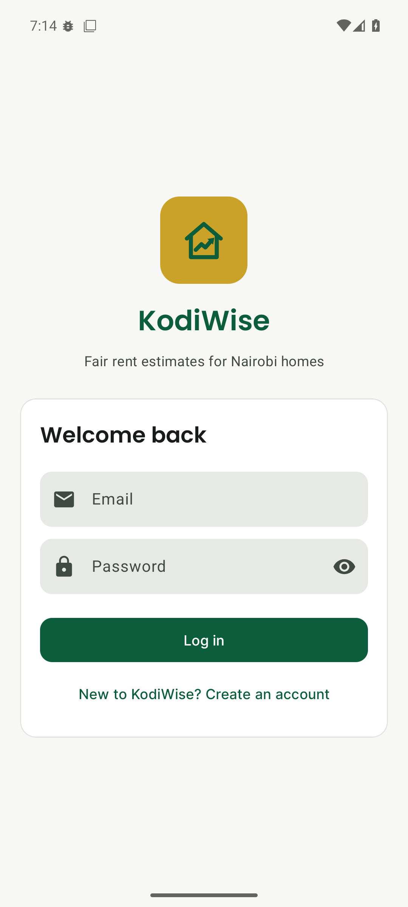
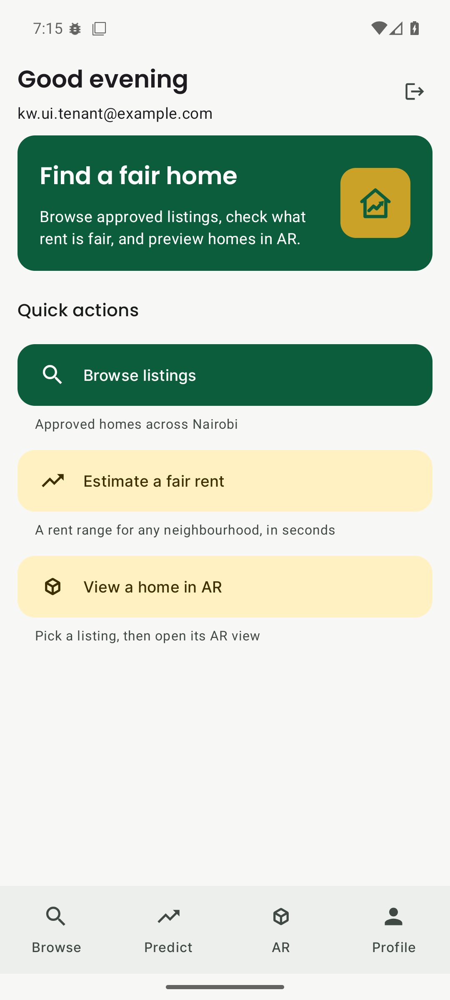
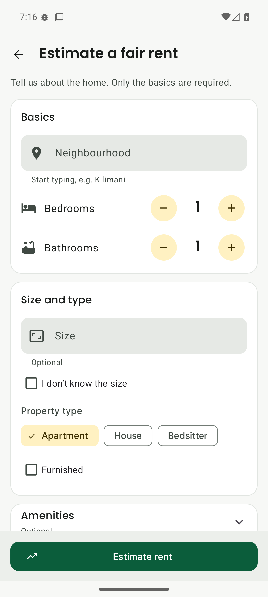
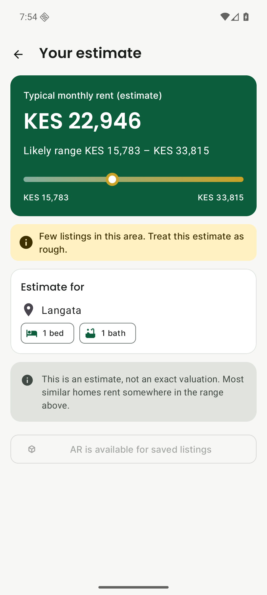
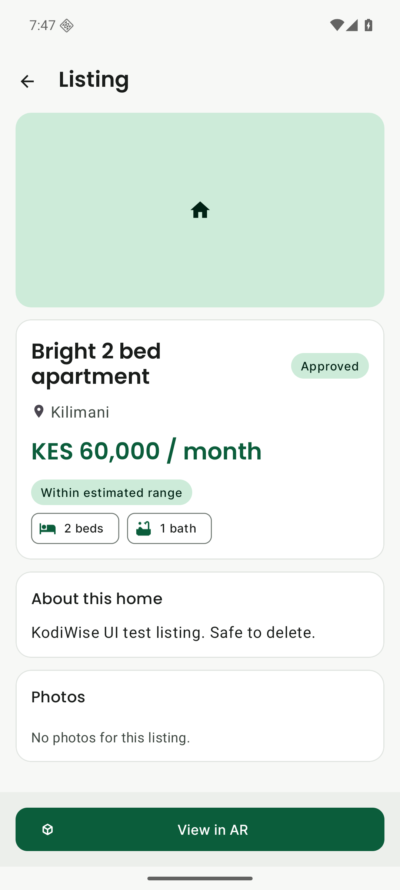
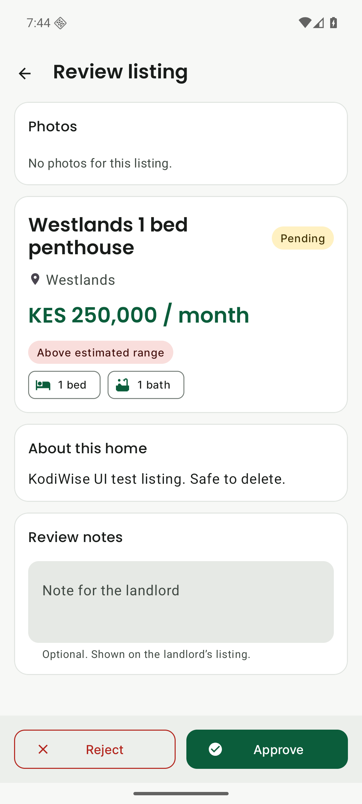
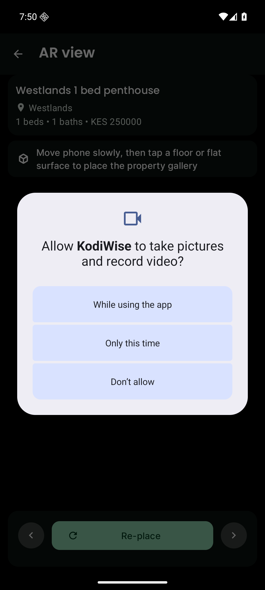
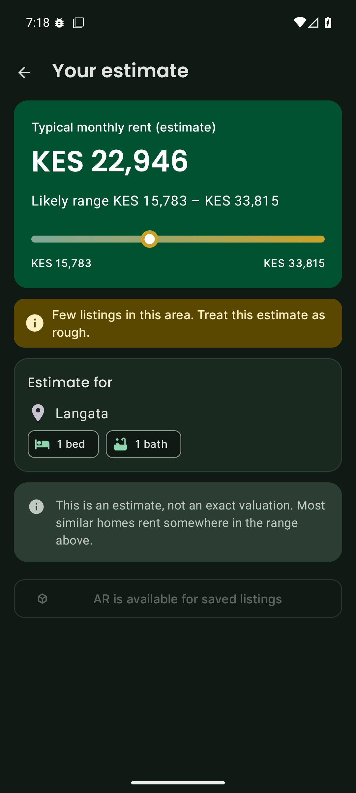
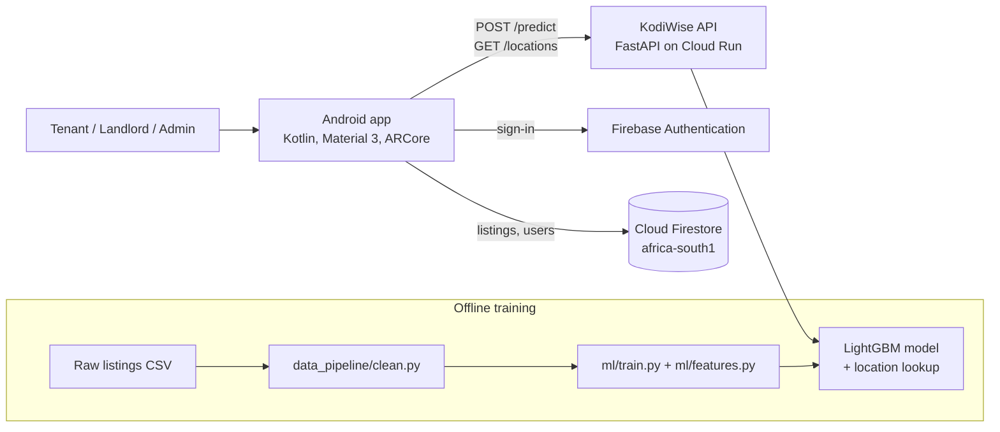

# KodiWise

**Fair rent estimates for Nairobi homes, with augmented-reality previews.**

KodiWise is an Android app backed by a machine-learning API. A tenant or landlord enters what they know about a home (neighbourhood, bedrooms, bathrooms and, optionally, size, type, furnishing and amenities) and gets an estimated monthly rent **as a range**, together with an honest note on how much local data supports that estimate. Landlords can list properties, an admin approves them, tenants browse approved listings and can place a listing's photo gallery in their room using augmented reality (AR).

*Kodi* is Swahili for "rent".

KodiWise is the product successor to **RentAR**, my MSc research prototype at Strathmore University, which was published as a conference paper (see [Research background](#research-background)). KodiWise rebuilds that prototype around one principle: **the model must only learn from information the app can actually collect from a user**, and every number it shows must be one we can defend.

---

## Contents

1. [Features](#features)
2. [Screenshots](#screenshots)
3. [How it works](#how-it-works)
4. [Repository structure](#repository-structure)
5. [The machine-learning model](#the-machine-learning-model)
6. [Results](#results)
7. [The prediction API](#the-prediction-api)
8. [The Android app](#the-android-app)
9. [Data model and security rules](#data-model-and-security-rules)
10. [Getting started](#getting-started)
11. [Testing](#testing)
12. [Model versioning and deployment rule](#model-versioning-and-deployment-rule)
13. [Limitations](#limitations)
14. [Roadmap](#roadmap)
15. [Research background](#research-background)
16. [Author](#author)

---

## Features

**For tenants**
- Estimate a fair monthly rent for any of 32 Nairobi neighbourhoods, shown as a likely range (low – estimate – high) rather than one misleading number.
- Location confidence hint: *high*, *low* ("treat this estimate as rough") or *none* ("based mostly on the Nairobi average").
- Browse admin-approved listings, search them, and see whether a listing's asking rent is **within, above or below** the estimated range.
- Place a listing's photo gallery in the room with AR on ARCore phones; phones without ARCore get a details screen instead.

**For landlords**
- Add a listing (neighbourhood picked from a validated list, size, type, furnishing, amenities). Each listing is priced against the model at upload time.
- Manage and delete their own listings; see approval status (pending, approved, rejected) and admin notes.

**For admins**
- Review pending listings and approve or reject them with a note.
- A performance screen for timing API and database calls.

**Across the app**
- Material 3 design in a deep-green and gold theme, with full light and dark mode.
- Role-based routing (tenant, landlord, admin) with a bottom navigation bar for each role.
- Accessibility: 4.5:1 contrast, 48 dp touch targets, labelled icons.

---

## Screenshots

| Login | Tenant home | Rent estimate form | Estimate result |
|---|---|---|---|
|  |  |  |  |

| Listing detail | Admin review | AR view | Dark mode |
|---|---|---|---|
|  |  |  |  |

More screens, in light and dark mode, are in [`docs/screenshots/after/`](docs/screenshots/after/).

---

## How it works



1. **Data**: rental listings scraped from Kenyan property sites are cleaned by `data_pipeline/clean.py`.
2. **Training**: `ml/train.py` builds features with `ml/features.py` and trains a LightGBM model. Every model is saved as an immutable, versioned folder with its metrics.
3. **Serving**: the API in `api/` loads one model version and uses **the same `ml/features.py` code** to turn a request into features, so training and serving cannot drift apart.
4. **App**: the Android app calls the API for estimates and uses Firebase for sign-in and listings.

---

## Repository structure

```
KodiWise/
├── android_app/            Android app (Kotlin, XML views, Material 3, ARCore)
│   └── app/src/main/java/com/kodiwise/app/
├── api/                    FastAPI prediction service
│   ├── main.py             endpoints
│   ├── predictor.py        loads the model, builds features, returns a range
│   └── schemas.py          request/response models (Pydantic)
├── ml/                     model code and saved versions
│   ├── features.py         single source of truth for features (train + serve)
│   ├── train.py            training, versioning, deploy comparison
│   ├── evaluate.py         metrics, cross-validation, baselines
│   └── models/<version>/   metrics, feature importance, location lookup
├── data_pipeline/
│   ├── clean.py            cleaning rules, logs every dropped row
│   └── geocode.py          neighbourhood centroids, reference points and roads (OpenStreetMap)
├── data/reference/         neighbourhood_centroids.csv, pois.csv, roads.csv (+ cached OSM responses)
├── tests/                  pytest suite (features, cleaning, API, deploy rule)
├── docs/screenshots/       before/after app screenshots
├── firestore.rules         database security rules
├── firestore.indexes.json  composite indexes
├── Dockerfile              API container image
└── requirements.txt        pinned Python dependencies
```

Raw listing data and trained model binaries are deliberately **not** committed (see `.gitignore`); the OpenStreetMap-derived reference files in `data/reference/` are.

---

## The machine-learning model

### Data

The starting dataset has **580 Nairobi rental listings** (489 from Jiji, 91 from KenyaPropertyCentre) across 34 neighbourhoods, with 60 columns.

### Cleaning (`data_pipeline/clean.py`)

Each rule runs in order and logs row counts; every removed row is written to `dropped_rows.csv` with a reason.

| Step | Rule | Rows |
|---|---|---|
| Start | Raw listings | 580 |
| 1 | Drop listings outside Nairobi County (e.g. a Nakuru listing labelled "Pipeline") | −1 |
| 2 | Drop short-stay listings (Airbnb, per-night, hostel, daily/weekly) by title keywords | −18 |
| 3 | Drop rents under KES 8,000 (short-let or mislabelled) | −9 |
| 4 | Keep rents between KES 3,000 and 300,000 | 0 |
| 5 | Drop dead columns; floor area outside 15–1,000 m² treated as missing (34 values, no rows dropped) | 0 |
| **Result** | | **552** |

### Avoiding leakage

The original research prototype reached R² ≈ 0.97 because some features were computed from the rent itself (price per bedroom, location averages over all data). KodiWise removes every such feature:

- No feature may be derived from the target (rent).
- Location statistics (mean, median, count) are computed **from the training split only**, smoothed towards the city mean (weight *m* = 5), and **recomputed inside each cross-validation fold**.
- Unknown neighbourhoods fall back to the Nairobi average and are flagged.

### Avoiding training–serving skew

The most important lesson of this project. A model that scored **R² 0.77** on held-out listings turned out to depend mostly on the listing's *title* (title length alone was the top feature, because it identified which website a listing came from, and the sites differ in price level). The app never has a real title, so when that model was given the inputs the app actually sends, its R² fell to **−0.38**: worse than always guessing the average.

KodiWise therefore trains only on fields a user can enter in the app:

| Group | Features |
|---|---|
| Required | neighbourhood, bedrooms, bathrooms |
| Optional | floor area (m², with "don't know"), furnished, property type (apartment / house / bedsitter) |
| Optional amenities | generator, borehole, CCTV, DSQ, play area, garden |
| Derived | rooms total, bathrooms per bedroom, location mean/median/count (training data only) |
| Location geography | neighbourhood latitude/longitude; km to the CBD, Westlands, Upperhill, JKIA, Thika Road and Mombasa Road (looked up from the neighbourhood name) |

### Model

- **LightGBM** regression on `log1p(rent)` (via `TransformedTargetRegressor`).
- Hyperparameters: 2,000 trees, learning rate 0.03, 64 leaves, min 15 samples per leaf, 0.85 row and column subsampling, L1/L2 0.2.
- Stratified 80/20 split by income band, 5-fold cross-validation.
- Compared against Ridge regression, Random Forest and XGBoost.

### Prediction range

Instead of one number, the API returns the 10th–90th percentile range of the model's cross-validation errors (in log space) around the estimate. Typical range width for the served model is about KES 50,000.

### Location confidence

Some neighbourhoods have very few listings, so their average is effectively one or two homes. Each prediction reports:

| Confidence | Training listings in the neighbourhood | What the app shows |
|---|---|---|
| high | 10 or more | no note |
| low | 3–9 | "Few listings in this area. Treat this estimate as rough." |
| none | fewer than 3, or unknown | "Not enough local data. This estimate is based mostly on the Nairobi average." |

---

## Results

All figures are on the held-out test set unless marked CV (5-fold cross-validation).

| Run | Features | Test R² | Test MAPE | Status |
|---|---|---|---|---|
| A: research reproduction | full research feature set, 580 rows | 0.723 | 25.2% | matches the published paper (R² 0.724, MAPE 25.3%) |
| B: cleaned, all features | includes title text | 0.774 | 20.2% | **not usable**: R² −0.38 with real app inputs |
| C: app inputs only | neighbourhood, bedrooms, bathrooms | 0.489 | 41.3% | first honest baseline |
| D: expanded app form | C + size, type, furnishing, amenities | 0.736 | 24.7% | previous production (`v20261107-appD`) |
| **E2: D + GPS (served)** | D + neighbourhood coordinates and distances | **0.748** | **24.8%** | in production (`v20261107-appE2`) |

Baselines on the same split for the served model: Random Forest R² 0.744 / MAPE 25.0%, XGBoost 0.736 / 23.3%, Ridge −0.235 / 30.9%.

Adding six form fields recovered almost all of the accuracy that title text had been faking, and the typical estimate range became about 31% narrower than with Run C.

**GPS features (Run E2).** Each neighbourhood gets OpenStreetMap coordinates and distances to the CBD, Westlands, Upperhill, JKIA, Thika Road and Mombasa Road; the app request does not change. Compared with Run D on the same rows and folds, averaged over 5 training seeds, mean test MAPE went from 24.91% to 24.66% and CV R² from 0.719 to 0.720. The gain is concentrated where location data is thin: out-of-fold error for neighbourhoods with 3–9 training listings fell by about 5 points (34.6% → 29.5%), while neighbourhoods with fewer than 3 listings did not improve (42.8% → 44.0%), so their "not enough local data" label stays. A variant that also borrowed rents from nearby neighbourhoods (Run E, a spatial prior) added nothing measurable and is not served. On the single split in the table, E2's MAPE is 0.1 points above D's; the 5-seed comparison is the deciding measure, because training noise alone moves test MAPE by up to ~0.8 points at this data size.

---

## The prediction API

FastAPI service in `api/`, containerised with the root `Dockerfile` and deployed to Google Cloud Run (africa-south1, scales to zero).

| Method | Path | Purpose |
|---|---|---|
| GET | `/health` | Service status and loaded model version |
| GET | `/model-version` | Version, feature set and test metrics of the served model |
| GET | `/locations` | The 32 neighbourhoods the model recognises |
| POST | `/predict` | Rent estimate with range and confidence |

**Request** (only the first three fields are required):

```json
{
  "bedrooms_num": 2,
  "bathrooms_num": 2,
  "location_std": "kilimani",
  "sq_m": 110,
  "is_furnished": 1,
  "property_type": "apartment",
  "has_generator": 1,
  "has_borehole": 1,
  "has_cctv": 1
}
```

**Response**

```json
{
  "predicted_rent_kes": 139313.54,
  "predicted_rent_low_kes": 94734.21,
  "predicted_rent_high_kes": 208461.66,
  "model_version": "v20261107-appE2",
  "location_recognised": true,
  "location_confidence": "high",
  "note": "Estimate only, not an exact valuation. ..."
}
```

Location names are matched case-insensitively, with a small alias table (e.g. "Westland" → Westlands, "Upper Hill" → Upperhill). Invalid input returns HTTP 422 with a clear message.

---

## The Android app

- **Language and UI**: Kotlin, XML views, Material 3 (`Theme.KodiWise`), Poppins and Inter fonts, light and dark themes.
- **Package**: `com.kodiwise.app`, min SDK 24, target SDK 36.
- **Backend**: Firebase Authentication (email and password), Cloud Firestore, Retrofit for the API.
- **AR**: ARCore. Before opening AR the app checks ARCore support; unsupported phones, or users who deny camera access, are sent to a fallback details screen. If support can't be determined, a "Try AR anyway" button re-checks.
- **Roles**: `RoleRouter` reads `users/{uid}.role` and opens the tenant, landlord or admin dashboard.
- **Key screens**: `PredictionFormActivity`, `PredictionResultActivity`, `PropertyUploadActivity`, `PropertyListActivity`, `PropertyDetailActivity`, `AdminApprovalsActivity`, `AdminReviewPropertyActivity`, `ARViewActivity`, `ARFallbackActivity`.
- **Configuration**: the API address is a Gradle property (`KODIWISE_API_URL`). If it is not set, the build uses the deployed KodiWise API.

Property photos are not stored in this version, because Firebase Storage requires a paid plan; listings save without images.

---

## Data model and security rules

**Firestore collections**

- `users/{uid}`: `email`, `role` (`tenant`, `landlord` or `admin`).
- `properties/{id}`: title, `locationName`, bedrooms, bathrooms, `sq_m`, property-type and amenity flags, `quotedRent`, `predictedRent`, `predictedLow`, `predictedHigh`, `locationConfidence`, `status` (`pending`, `approved`, `rejected`), `ownerId`, `adminNotes`, AR placement values, `createdAt`.

**Rules (`firestore.rules`)**

- Users can only read and edit their own profile; at sign-up the role must be tenant or landlord, and the role can never be changed from the app. Admins are assigned by hand in the Firebase console.
- New listings must be created by their owner with status `pending`.
- Owners can edit their listings but cannot change the status (no self-approval) or the owner.
- Admins can set the status to approved, rejected or pending.
- Tenants can read approved listings only; owners and admins can also read pending ones.
- Everything else is denied.

---

## Getting started

### Prerequisites

- Python 3.12
- Android Studio (recent stable) and an Android phone with ARCore for the AR features
- A Firebase project (free Spark plan is enough)
- Optional, to deploy the API: Google Cloud SDK and a Google Cloud project with billing enabled

### 1. Python environment

```bash
python -m venv .venv
# Windows: .venv\Scripts\activate    macOS/Linux: source .venv/bin/activate
pip install -r requirements.txt
```

### 2. Data and training

The listings dataset is not included in this repository. Place the raw CSV at `data/raw/nairobi_rentals_enriched_v4.csv`, then:

```bash
python -m data_pipeline.clean
python -m ml.train      # trains, evaluates and saves a new version
```

Each run saves the model under the version name set in `ml/train.py` (`RUN_D_VERSION`). Training refuses to overwrite an existing version folder, so set a new version name before retraining.

### 3. Run the API locally

```bash
uvicorn api.main:app --reload
# open http://127.0.0.1:8000/docs for interactive API docs
```

### 4. Deploy the API (optional)

```bash
gcloud run deploy kodiwise-api --source=. --region=africa-south1 \
  --allow-unauthenticated --memory=512Mi --min-instances=0 --max-instances=2
```

`.gcloudignore` is written explicitly so that only the API code and the served model version are uploaded.

### 5. Firebase

1. Create a Firebase project and add an Android app with package `com.kodiwise.app`.
2. Enable **Authentication → Email/Password** and create a **Firestore** database.
3. Download `google-services.json` into `android_app/app/` (it is git-ignored; see `google-services.json.example`).
4. Deploy the rules and indexes:

```bash
firebase deploy --only firestore:rules,firestore:indexes --project <your-project-id>
```

To create an admin, register in the app, then change that user's `role` to `admin` in the Firestore console.

### 6. Android app

1. In Android Studio choose **File → Open** and select the `android_app` folder.
2. Optional: to use your own API, set `KODIWISE_API_URL=https://<your-api-url>/` as a Gradle property (for example in `~/.gradle/gradle.properties`, or pass `-PKODIWISE_API_URL=...`). Without it the app uses the deployed KodiWise API.
3. Connect a phone with USB debugging and press **Run**.

---

## Testing

```bash
pytest
```

The Python suite covers cleaning rules, feature building (including location matching and confidence levels), the API contract, and the model deployment rule. The Android app has unit tests for the rent-range badge, location validation, confidence hints and the AR launcher:

```bash
cd android_app
./gradlew test          # Windows: gradlew.bat test
```

---

## Model versioning and deployment rule

- Every trained model gets an immutable folder `ml/models/v<date>-<feature set>/` with `metrics.json`, `feature_importance.json`, `location_lookup.json` and the exact evaluation rows used.
- A new model is compared with the deployed one **on the same test rows and the same cross-validation folds**, averaged over **5 training seeds** (LightGBM's sampling alone moves test MAPE by up to ~0.8 points).
- It may replace the deployed model only if mean test MAPE is not worse by more than 0.5 percentage points **and** mean CV R² is not lower by more than 0.01. Anything else needs a manual decision.
- The previous version is kept for rollback.

---

## Limitations

- **Small dataset**: about 550 listings; several neighbourhoods have only one or two, which is why the app reports location confidence.
- **Asking rents, not agreed rents**: listings show what landlords ask, which may differ from what tenants pay.
- **Two sources, one point in time**: scraped from two websites in early 2026; prices drift.
- **Wide ranges**: a typical range is about KES 50,000 wide; the estimate is a guide, not a valuation.
- **No photos** in this version (free Firebase plan).

---

## Roadmap

1. ~~**GPS features**~~: done (Run E2). Next step: per-listing coordinates where listing pages expose a map pin.
2. **Explanations**: per-prediction SHAP values ("size added KES X").
3. **Scheduled scraping**: more listings from more sources, prioritising low-data neighbourhoods.
4. **Monthly retraining**, gated by the deployment rule above.
5. **On-device model** (ONNX) for offline estimates.
6. **Conversational assistant** that answers rent questions using the API as a tool.

---

## Research background

KodiWise grows out of my MSc dissertation at Strathmore University (supervised by Bernard Shibwabo) and the paper:

> B. Mitigoa and B. Shibwabo, "A LightGBM and Augmented Reality-Based Model for Rental Housing Price Prediction and Visualisation," presented at ASCIC 2026; to appear in Springer *Lecture Notes in Networks and Systems*.

The leak-free results reported in the paper are reproduced exactly by Run A above. KodiWise goes further by matching the model's inputs to what a real app user can provide.

---

## Author

**Baraka Mitigoa**, Nairobi, Kenya
MSc Computing and Information Systems, Strathmore University
GitHub: [@bmitigoa](https://github.com/bmitigoa) · ORCID: [0009-0004-0349-2917](https://orcid.org/0009-0004-0349-2917)

## Data credits

Neighbourhood coordinates, reference points and road geometry in `data/reference/` come from OpenStreetMap: © OpenStreetMap contributors, available under the Open Database Licence (ODbL).

## Licence

MIT — see LICENSE.
